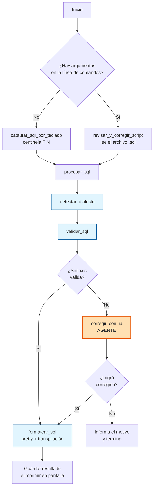
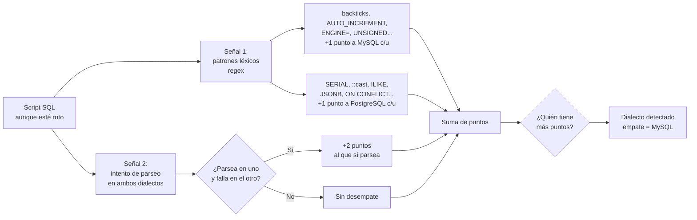
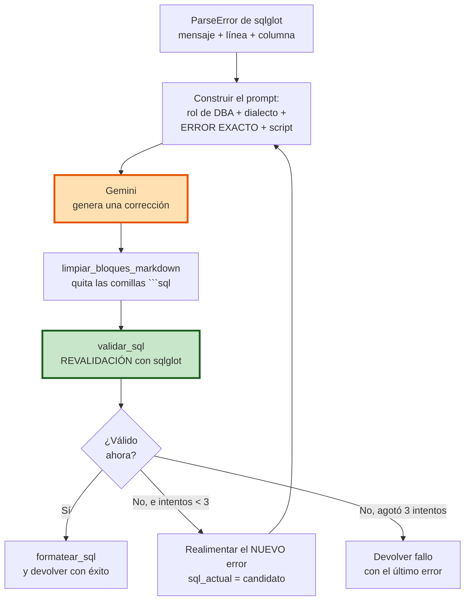

# Diagrama de flujo — Ciclo del agente corrector

> Para mostrar en la sustentación. GitHub renderiza estos diagramas automáticamente:
> basta con abrir este archivo en el repositorio y compartir pantalla.

## 1. Flujo general del programa

Azul = capa determinista (`sqlglot`). Naranja = capa de agente (Gemini).

---

## 2. Detección del dialecto — dos señales independientes

**Por qué dos señales:** un script con errores de sintaxis **no parsea en ningún
dialecto**, así que la señal 2 queda neutralizada y solo los patrones léxicos pueden
identificarlo. Es exactamente el caso de `mysql_con_errores.sql`, que se detecta como
MySQL con 6 puntos a 0 pese a que `valido_mysql` y `valido_postgres` son ambos `False`.

---

## 3. El lazo del agente — lo que hay que explicar

### La idea en una frase

> **El modelo propone, la herramienta determinista dispone.**

La respuesta de Gemini **nunca** se acepta sin verificar. Cada propuesta vuelve a pasar
por `sqlglot`, y si falla, el nuevo error se le devuelve al modelo para que reintente.
Ese lazo cerrado `generar → verificar → realimentar → reintentar` es lo que convierte el
programa en un **agente**, y no en una simple llamada a una IA.
